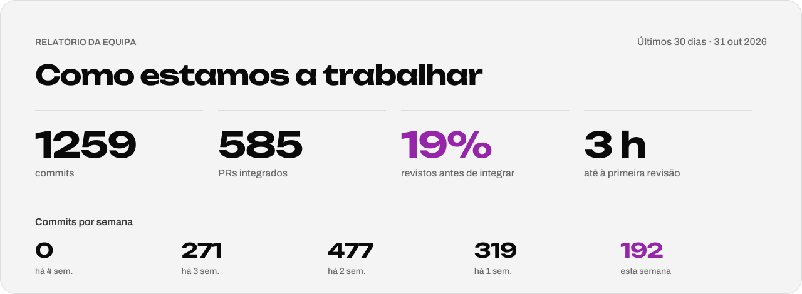
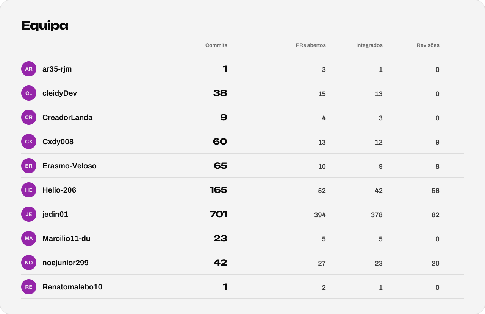
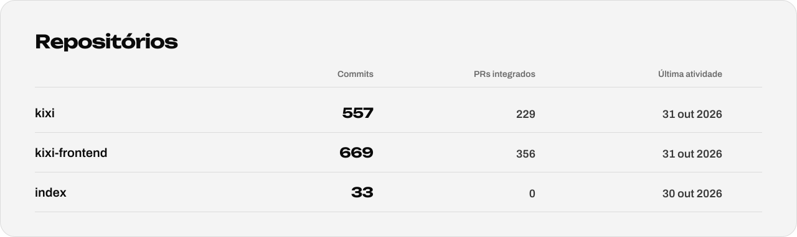

  <a href="https://creative-mode.github.io/index/">
    <picture>
      <source media="(prefers-color-scheme: dark)" srcset="./github-banner-dark.svg">
      
    </picture>
  </a>

<!-- relatorio:inicio -->

<picture><source media="(prefers-color-scheme: dark)" srcset="./relatorio-resumo-dark.svg"></picture>

<picture><source media="(prefers-color-scheme: dark)" srcset="./relatorio-equipa-dark.svg"></picture>

<picture><source media="(prefers-color-scheme: dark)" srcset="./relatorio-repositorios-dark.svg"></picture>

Atualizado automaticamente todas as segundas-feiras · 31 out 2026

<!-- relatorio:fim -->
